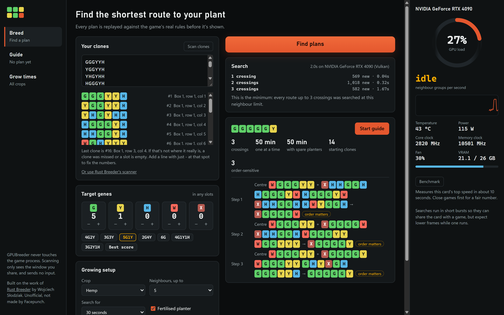
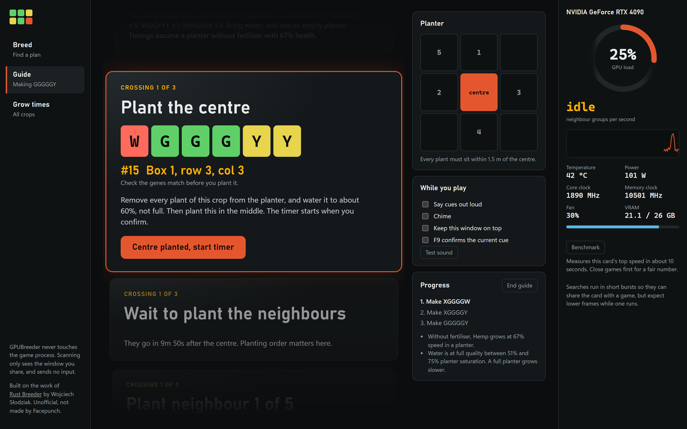
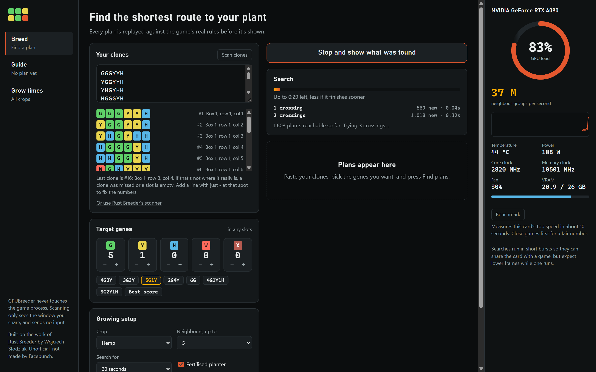
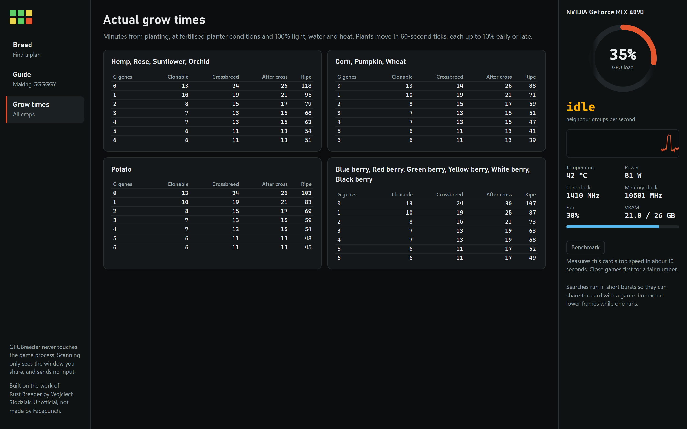

# GPUBreeder

**Plan Rust crossbreeds on your graphics card, then follow a step-by-step guide while you plant.**

GPUBreeder scans your clones from the screen, searches every route to the genes you want, and
proves the shortest one. Then it talks you through the planting, step by step, with the box, row
and column of every clone you need.



<!-- TODO: GIF of Scan filling the clone list in game, with name and server hidden. -->

> [!NOTE]
> GPUBreeder is an unofficial fan tool. It is not made, endorsed or supported by Facepunch Studios.
> Rust is a trademark of Facepunch Studios.

## Built on Rust Breeder

This project wouldn't exist without [**Rust Breeder**](https://rustbreeder.com) by
**Wojciech Słodziak** ([source](https://github.com/FlareFlo/rust-breeder),
[Discord](https://discord.com/invite/Va5475pqFw)). Rust Breeder worked out the problem, showed what a good answer looks like, and has been
the answer key for every part of GPUBreeder:

- Its example clone lists are our test data.
- Our tests check results against the live site, version 3.0.4.
- Our scanner was tested against clone lists read by its scanner.
- The paste format and the idea of scanning clones from the screen both come from it.

If you're happy with Rust Breeder in your browser, keep using it, and consider thanking its author.
GPUBreeder is for players who want an exhaustive search, a planting guide and a scanner that works
at any resolution. No Rust Breeder code is copied here. See [NOTICE.md](NOTICE.md).

## What it does

- **Scans your clones.** Press **Scan clones**, share the Rust window, and click through your clones.
  It finds the gene panel at any resolution, aspect ratio or window position, and only needs each
  clone on screen for about 70 ms. Pasting a list works too.
- **Finds the shortest route.** It searches cheapest-first on the GPU, so when it finds your target it
  can say the route is the minimum, not just a good one.
- **Gets the order right.** In the game, tied genes are settled by planting order, not chance. Plans
  say when order matters and give the exact order. See [docs/RULES.md](docs/RULES.md).
- **Guides you through it.** Every cue is laid out in one list. The current one is in focus, and
  the next few stay readable, so you can get their clones ready. Each says what to plant and where
  to find it, such as "#50, box 2, row 1, col 2". Each wait names what to look for on the plant,
  such as "the centre shows Seedling 35%, and no later than Sapling 82%". A timer estimates when
  that happens from real grow times for your planter, but only as a prompt to go and look. You
  move on when the plant matches, and can step back or skip at any time. A voice, a chime and an
  F9 hotkey let you stay in the game.



| Search in progress | Grow times |
|---|---|
|  |  |

## Download

Get the latest Windows build from the [Releases](../../releases) page. Unzip it and run
`GPUBreeder.exe`. It needs Windows 10 or 11 on x64, a graphics card with DirectX 12 or Vulkan, and
Microsoft's WebView2 runtime, which Windows 11 already has.

The builds aren't code-signed yet, so Windows SmartScreen may warn you the first time. Choose
**More info**, then **Run anyway**. To check the download is the one GitHub built from this source,
compare it with its `.sha256` file, or run `gh attestation verify <file>` with this repository's
name.

The command line is in the same zip as `gpubreeder-cli.exe`. A Linux build of it is also on the
Releases page.

## Is it safe with Easy Anti-Cheat?

GPUBreeder has no contact with the game. It opens no handle to the game process, injects nothing,
draws no overlay, reads no game memory and sends no input.

- **Scanning** uses the same browser screen sharing as Rust Breeder in Chrome, or as Discord and
  OBS. It runs only while you've pressed Scan, and only sees the window you pick.
- **Telemetry** comes from NVIDIA's read-only NVML library, which has no driver of its own.
- **F9** is an ordinary Windows hotkey, claimed only while a guide runs.

Nobody outside Facepunch and EAC can promise how they treat any tool. If you'd rather not capture
the screen at all, paste your list instead.

## Graphics cards

GPUBreeder runs on any card with DirectX 12 or Vulkan, but so far it has only been tested on an
NVIDIA RTX 4090. Every result from the card is re-checked on the CPU against the game's rules, so a
driver bug should mean missed routes rather than a wrong plan. A missed route could still make a
plan look like the shortest when it isn't.

To check your card, run the self-test from the folder you unzipped:

```bash
gpubreeder-cli --selftest
```

It runs 34 searches on your card and your CPU and compares them, which takes a minute or more. If it
says anything other than PASS, please open an issue with its output. Reports from AMD, Intel and
integrated graphics are especially welcome. The GPU panel's temperature and clock readings only
work on NVIDIA for now.

To see how fast your card is, press **Benchmark** in the app's GPU panel or run
`gpubreeder-cli --benchmark`. Every machine runs the same 100-clone workload, so results compare.
An RTX 4090 manages about 240 million neighbour groups a second, with Rust also running.

On a machine with more than one card, set `GPUBREEDER_ADAPTER` to part of a card's name to choose it.

## Command line

```bash
gpubreeder-cli --genes "WGXYYW,WGGXYW,WGYXGW" --mix 3G3Y
```

| Option | Default | Meaning |
|---|---|---|
| `-g, --genes` | | Your plants, separated by spaces or commas |
| `-f, --file` | | Read your plants from a file instead |
| `-m, --mix` | | Stop at the cheapest plant with these genes in any slots, such as `3G3Y` |
| `-t, --target` | | Stop at this exact genotype, in this exact slot order |
| `--max-crossings` | 12 | Most crossings to spend on one plant |
| `--plants` | 5 | Most neighbours around a centre, 1 to 8 |
| `--seconds` | 60 | Stop searching after this long |
| `--top` | 3 | Plans to print when there is no target |
| `--cpu` | off | Use the CPU instead of the GPU |
| `--selftest` | | Compare your GPU with the CPU and print a report |
| `--benchmark` | | Measure your GPU's top speed in neighbour groups per second |

Slot position has no effect in the game, so `--mix` is usually what you want. With no goal, the
search runs until `--seconds` and prints the highest-scoring plans. Work grows very quickly with
`--plants`. Set `GPUBREEDER_TRACE=1` to see each batch.

## How it works

The search runs cheapest-first. It finds everything one crossing can make, then everything two can
make, and so on, so each genotype is settled at its cheapest cost. A plant costs the crossings
needed to make it, and a crossing costs one plus the distinct plants it uses. Sub-plans shared by
two branches are counted once per branch during the search, so a printed plan can be shorter than
that price.

The GPU tries every group of neighbours around every centre, as a compute shader written in WGSL
and run through [wgpu](https://wgpu.rs). Searches run in short batches so the card can still draw
your game.

To stay correct:

1. `rules::game_cross` follows the game step by step, including its 32-bit float weights.
2. The GPU and CPU searches use faster integer logic.
3. Every result must pass `game_cross` with a concrete planting order, or the run stops with an
   error. Each plan is then replayed from your starting plants before it's shown.

The desktop app is built with [Tauri](https://tauri.app), with plain HTML, CSS and JavaScript for
the interface. The scanner is in [app/ui/scan.js](app/ui/scan.js). It finds the row of six gene
badges by colour and shape, then reads each letter by comparing it with stored letter shapes.

## Building from source

You need [Rust](https://rustup.rs) 1.85 or newer. Node.js is only needed for the scanner tests.

```bash
cargo build --release --workspace
```

This builds `target/release/gpubreeder-app.exe` (the desktop app, Windows only) and
`target/release/gpubreeder` (the command line). On Linux, build only the command line with
`cargo build --release -p gpubreeder`.

```bash
cargo test --workspace --release -- --test-threads=1
```

```bash
node --test app/tests/scan.test.cjs
```

The tests cover the rules against every planting order, the CPU search against brute force, the
GPU against the CPU, results against the live rustbreeder.com, and the scanner against real
screenshots. GPU tests need a GPU. Without one, set `GPUBREEDER_ADAPTER` to `Basic Render` on
Windows or `llvmpipe` on Linux to use a software renderer, which is what CI does.

## Status

This is an early release. Plans are checked against the rules in [docs/RULES.md](docs/RULES.md),
which come from game build 26431843, and a game update could change them. In-game testing of full
guides is under way. If a plan doesn't produce what it promised, please open an issue with the plan
and what grew.

## Licence

MIT. See [LICENSE](LICENSE). Credits and third-party notices are in [NOTICE.md](NOTICE.md).
